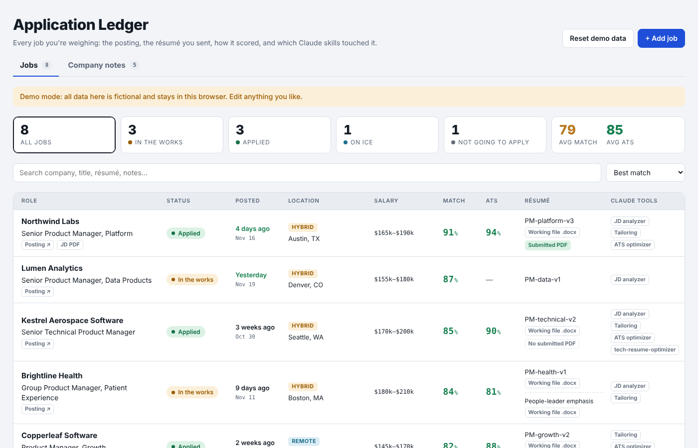

# Application Ledger

A job-search tracker built around one question: *which résumé did I send to which job, and how well did it fit?*

**[Live demo](https://karenweston.github.io/application-ledger/)** (sample data only, saved in your browser)



## Why I built it

Tailoring a résumé per role means a lot of versions. After a few weeks I couldn't tell which version went where, or whether the tailored one actually scored better. I wanted one place that holds the posting, the exact PDF I submitted, the scores, and my notes, and that makes a status check take a few seconds.

## What it does

- **One row per job.** Status, posting date, location and work mode, salary range, match and ATS scores, résumé version and the tools used.
- **Status tiles are filters.** Click In the works, Applied, On ice or Not going to apply to narrow the list. Averages for match and ATS sit alongside.
- **Résumé versions.** Keep several versions per job, each with its own working file, plus the PDF that was actually submitted, viewable in the page.
- **Company notes.** Track places you'd like to work before there is a role, with an interest level and a link to the jobs you've logged there.
- **Search and sort** across company, title, résumé, notes and tools.
- Responsive layout, light and dark themes, keyboard-accessible rows and dialogs.

## Run it

No build step. Serve the folder with any static server:

```sh
python3 -m http.server 8000
# open http://localhost:8000
```

On GitHub, enable Pages from the `main` branch and the demo is live.

## How it's put together

Plain HTML, CSS and JavaScript, with [pdf.js](https://mozilla.github.io/pdf.js/) for the in-page PDF viewer.

| File | Role |
| --- | --- |
| `index.html`, `styles.css` | Markup and styling |
| `app.js` | UI and state; talks to storage only through `db`, `assets` and `user` |
| `demo.js` | Storage adapter: a localStorage-backed stand-in for those three services, seeded with fictional data |
| `assets/` | Two sample PDFs used by the demo |

The app began as a Claude artifact, where those services are provided by the host and data is stored in the user's account. `demo.js` implements the same small interface locally. To make this a real multi-device app, replace `demo.js` with an adapter for Supabase, Firebase or your own API; `app.js` doesn't change.

## Limits of the demo

- Data lives in your browser's localStorage. Clearing site data clears it.
- Files you upload in the demo last for the session only. The two sample PDFs are static files.
- Everything shown is fictional, including companies, salaries and scores.

## What I'd build next

- A real backend with sign-in, so the ledger works across devices.
- Reminders for follow-up dates that have passed.
- A funnel view (found, applied, screen, interview) to see where applications stall.
